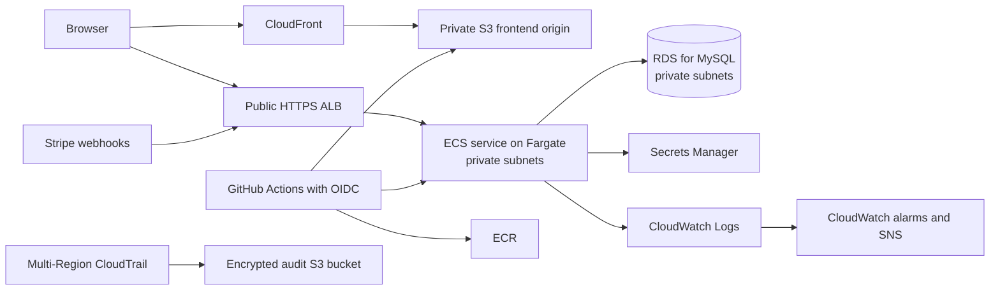

# Phase 3 and 4 Plan: AWS Deployment and Defensible Interview Evidence

Updated after a repository review on 2026-08-31.

## Outcome we are building toward

ShopSphere currently runs as a local three-container system: a React/Nginx frontend, a Spring Boot backend, and MySQL. The target is a small production-style AWS deployment:



This is useful because it demonstrates more than knowing AWS product names:

- **ECS on AWS Fargate** runs the existing backend image without managing EC2 hosts and replaces the local backend container.
- **RDS for MySQL** replaces the local database container with managed storage, backups, patching, and private network access.
- **S3 plus CloudFront** is a better fit for a compiled Vite SPA than keeping the frontend Nginx container running continuously.
- **Terraform** makes network, database, compute, IAM, DNS, and monitoring reproducible and reviewable.
- **CloudWatch** answers operational questions: Is the application healthy? Are requests failing? Is the database constrained?
- **CloudTrail** answers audit questions: Who changed an AWS resource, when, and with which identity?
- **GitHub Actions OIDC** deploys without storing long-lived AWS access keys in GitHub.

## Résumé wording

Use this only after all acceptance evidence in Phase 3 exists:

> Deployed a containerized Spring Boot service to Amazon ECS on AWS Fargate with an Amazon RDS for MySQL database using Terraform; delivered the React SPA through CloudFront from a private S3 origin, and implemented CloudWatch logging/alarms plus a multi-Region CloudTrail audit trail.

Why this differs from the draft:

- The repository has one backend service to deploy, so **service** is more precise than **services**.
- The React application is stored in S3 but users should receive it through CloudFront; **private S3 origin** states that boundary accurately.
- “CloudTrail audit trail” means a real trail delivering logs, not only the default 90-day event history.

Until deployment and verification are complete, use future-tense planning language in interviews. Do not put the deployment bullet on the résumé yet.

## Repository baseline

### Source-derived status

| Area | Current repository state | Planning consequence |
|---|---|---|
| Backend | One Spring Boot 3.2.2 service on Java 17 | Deploy one backend ECS service, not microservices |
| Frontend | React/Vite SPA; Docker image serves `dist` with Nginx | Build static files and deploy them to S3/CloudFront; do not deploy the frontend container to ECS |
| Local runtime | Compose runs MySQL, backend, frontend, and optional Adminer | AWS replaces Compose in the hosted environment; Compose remains the local developer path |
| Database | Flyway V1/V2 plus an uncommitted V3 migration | Run and verify migrations before RDS deployment |
| Payment hardening | Uncommitted code now contains inventory, pending/paid states, Stripe webhook verification, event records, product locks, and success-page polling | This is no longer a future “Phase 4 Step 0”; it is work in progress that needs review and tests |
| Health | Actuator exposes `/actuator/health` and `/actuator/info`; the backend Dockerfile checks health | Add explicit production readiness behavior and use it for the ALB target group |
| Security | JWT/RBAC exists; CORS currently accepts every origin | Production CORS must be environment-driven before public deployment |
| CI | Backend compiles/tests/packages and pushes to Docker Hub; frontend builds a Node matrix and also pushes an Nginx image | Separate CI from AWS deployment; backend goes to ECR, frontend `dist` goes to S3 |
| OpenAPI | Basic metadata only; Swagger endpoints are public | Add Bearer authentication documentation and choose an explicit production exposure policy |
| Infrastructure | No Terraform or AWS resources are present | The deployment résumé claim is not currently supported |

### Runtime verification performed during this review

- `npm run type-check` passes.
- `npm run build` fails because `Footer.tsx` resolves `../../assets/icon.png` from the wrong directory.
- The Maven wrapper cannot start because `.mvn/wrapper/maven-wrapper.jar` is corrupt (`zip END header not found`).
- Backend tests therefore remain unverified. The only committed backend test is a context-load smoke test.
- No AWS apply, endpoint smoke test, CloudWatch log query, alarm notification, or CloudTrail delivery has been verified.

These failures are Phase 3 entry blockers, not cleanup to postpone until after deployment.

## Important corrections to the original plan

1. **Stabilize the current payment branch before deployment.** The new Phase 2 changes are present but uncommitted and untested. At minimum, compile them and prove database migrations and payment transitions against MySQL.
2. **Replace DynamoDB state locking with S3 lockfiles.** Current Terraform supports `use_lockfile = true`; DynamoDB locking is deprecated. Enable S3 versioning and encryption for state recovery.
3. **Do not create eight Terraform modules immediately.** For one service and one environment, start with a few coherent modules. Refactor only when a boundary is reused.
4. **Build only a real `dev` environment first.** A mostly copied `prod/` folder is not evidence of production deployment. Add production only if it will actually be applied and operated.
5. **Keep ECS in private subnets with real outbound access.** The backend calls Stripe, so VPC endpoints alone cannot replace internet egress. Use one NAT gateway for the portfolio/dev environment; a high-availability production design would use one per Availability Zone.
6. **Keep secrets out of Terraform values and state.** Let RDS manage its master password in Secrets Manager. Create the names/ARNs for application secrets with Terraform, but set Stripe/JWT secret values through a controlled out-of-band step.
7. **Define deployment ownership.** Terraform owns stable ECS infrastructure. The deployment workflow owns new task-definition revisions and the service's current revision. Document the lifecycle rule that prevents Terraform from reverting a deployment.
8. **Use immutable backend image identifiers.** Deploy the Git commit SHA or image digest, not `latest`.
9. **Add rollback and evidence.** Enable the ECS deployment circuit breaker with rollback, wait for service stability in CI, and save a short verification record.
10. **Do not load-test Stripe itself.** Put Stripe behind an application interface and use a fake/test implementation for concurrency tests. Load-test this application, not an external payment provider.

---

# Phase 3: AWS Deployment With Terraform

Expected part-time duration: 2–3 weeks after the deployment-readiness gate is green.

## Phase 3.0: Deployment-readiness gate

Complete these before creating chargeable AWS application resources:

- [ ] Fix the frontend asset import and prove `npm ci`, type-check, and production build.
- [ ] Regenerate or replace the corrupt Maven wrapper and prove `./mvnw test` and `./mvnw package` on Java 17.
- [ ] Add at least one MySQL-backed integration test that applies Flyway V1–V3 and loads the Spring context.
- [ ] Review and commit the current inventory/payment changes as a coherent change set.
- [ ] Make webhook and order transitions concurrency-safe. The current `alreadyProcessed` check and later `recordProcessedEvent` write are separate operations, so two deliveries can both enter processing. Lock the order row before state transitions and test duplicate completion and duplicate expiration in parallel.
- [ ] Replace `double`/`DOUBLE` money with `BigDecimal`/`DECIMAL`, or explicitly record it as unresolved technical debt. Do not describe exact payment accounting while binary floating point remains.
- [ ] Update the stale README: remove `/order/add`, update the Stripe SDK version, and stop linking to documentation files that do not exist.
- [ ] Choose an AWS region, a domain/subdomain plan, a monthly budget, and a teardown policy.

Exit evidence:

- Clean CI checks for frontend and backend.
- A Testcontainers/MySQL test proves Flyway can create the current schema.
- Parallel tests prove one terminal order transition and no double stock release.

## Phase 3.1: Production-aware application configuration

### Spring profiles

Create:

```text
backend/src/main/resources/application.properties
backend/src/main/resources/application-dev.properties
backend/src/main/resources/application-prod.properties
```

Responsibilities:

- `application.properties`: shared JPA, Flyway, JWT expiration, and application defaults that are safe everywhere.
- `application-dev.properties`: local MySQL URL/defaults and localhost CORS.
- `application-prod.properties`: no secret defaults, reduced log noise, health details hidden, and production CORS supplied from the environment.

Use standard Spring-compatible environment bindings where practical. Required production values:

```text
SPRING_PROFILES_ACTIVE=prod
SPRING_DATASOURCE_URL=jdbc:mysql://<private-rds-endpoint>:3306/ecommerce_v2
SPRING_DATASOURCE_USERNAME=<injected-secret-key>
SPRING_DATASOURCE_PASSWORD=<injected-secret-key>
JWT_SECRET=<injected-secret>
STRIPE_SECRET_KEY=<injected-secret>
STRIPE_WEBHOOK_SECRET=<injected-secret>
BASE_URL=https://app.<domain>/
CORS_ALLOWED_ORIGINS=https://app.<domain>
```

Implementation changes:

- Add typed `@ConfigurationProperties` for CORS instead of `allowedOriginPatterns("*")`.
- Permit only the React origin in production and localhost origins in development.
- Keep `/webhook/stripe` public but protect it with Stripe signature verification.
- Decide whether Swagger is disabled, authenticated, or IP-restricted in production; do not expose it accidentally.
- Add a request/correlation ID to application logs so CloudWatch records can be followed across one request.
- Expose a stable readiness path for the ALB, such as `/actuator/health/readiness`, and verify its behavior when MySQL is unavailable.

### Frontend configuration

- Continue using `VITE_API_BASE_URL`; Vite embeds it at build time.
- Build the AWS artifact with `https://api.<domain>/`.
- Retain the Nginx Dockerfile only for local/container demonstrations; it is not part of the AWS frontend path.
- Verify direct navigation to `/cart`, `/orders`, and `/admin/product` after CloudFront deployment.

## Phase 3.2: Terraform structure and state

Use this initial layout:

```text
infra/
├── terraform/
│   ├── bootstrap/                 # State bucket only; applied once with local state
│   ├── modules/
│   │   ├── network/               # VPC, subnets, routes, NAT, security groups
│   │   ├── data/                  # RDS and database secret wiring
│   │   ├── service/               # ECR, IAM, ALB, ECS, log group
│   │   ├── frontend/              # S3, CloudFront, ACM, Route53
│   │   └── observability/         # alarms, SNS, CloudTrail, audit bucket
│   └── environments/
│       └── dev/
│           ├── backend.tf
│           ├── providers.tf
│           ├── main.tf
│           ├── variables.tf
│           ├── outputs.tf
│           └── terraform.tfvars.example
├── ecs/
│   └── task-definition.json       # Deployment template; no secret values
└── scripts/
    ├── verify-deployment.sh
    └── deploy-frontend.sh
```

State requirements:

- Dedicated S3 state bucket with public access blocked, encryption, and versioning.
- S3 backend configured with `use_lockfile = true`.
- State path separated by environment, for example `shopsphere/dev/terraform.tfstate`.
- No credentials or secret values in `.tfvars`, plans, outputs, or Git.
- Pin Terraform and provider versions; commit `.terraform.lock.hcl`.

Quality checks:

- `terraform fmt -check -recursive`
- `terraform init -backend=false` and `terraform validate` in pull requests
- `terraform plan` for reviewed changes
- Optional: TFLint and Checkov/tfsec, with failures triaged rather than blindly ignored

## Phase 3.3: Network and security boundaries

Create one VPC across two Availability Zones:

- Two public subnets for the ALB and NAT gateway route.
- Two private application subnets for Fargate tasks.
- Two private database subnets for the RDS subnet group.
- Internet gateway for public subnets.
- One NAT gateway for the dev environment so the private backend can reach Stripe and AWS public endpoints.

Security-group rules:

| Group | Inbound | Outbound |
|---|---|---|
| ALB | TCP 443 from internet; TCP 80 only to redirect to 443 | TCP 8080 to ECS group |
| ECS | TCP 8080 from ALB group only | TCP 3306 to RDS and TCP 443 for Stripe/AWS APIs |
| RDS | TCP 3306 from ECS group only | Default/stateful response traffic |

Do not make RDS public. Do not open ECS port 8080 directly to the internet.

Cost note: a NAT gateway has a meaningful fixed and data-processing cost. VPC endpoints can reduce or privatize access to ECR, CloudWatch Logs, S3, and Secrets Manager, but Stripe still requires internet egress. Add an AWS Budget alert before leaving resources running.

## Phase 3.4: Database and secrets

RDS dev configuration:

- RDS for MySQL 8.0 in the private database subnets.
- Small supported instance class selected after checking the chosen region.
- Storage encryption and storage autoscaling.
- Automated backups with a short dev retention period.
- `publicly_accessible = false`.
- Deletion protection off only if the documented dev teardown flow requires it; production would enable it.
- Parameterize Multi-AZ rather than claiming it is enabled when the dev environment uses one instance.

Secret handling:

- Use RDS-managed master credentials in Secrets Manager for bootstrap/migration administration; do not leave the web application running permanently as the database master user.
- Provision a separate least-privilege application database user and secret. The runtime user needs ordinary application DML privileges; a separate migration identity can own Flyway DDL changes.
- Store JWT, Stripe API, and Stripe webhook secrets in Secrets Manager.
- Terraform may create secret containers and IAM references, but populate secret values outside Terraform so values do not enter state.
- Grant `secretsmanager:GetSecretValue` only to the ECS task execution role and only for named secret ARNs.
- Separate the ECS **execution role** (pull image, inject secrets, write logs) from the application **task role** (only permissions used by application code; likely none initially).
- ECS environment-secret injection happens when a task starts; running containers do not automatically receive a rotated value. Coordinate database/application secret rotation with a forced ECS deployment, or retrieve rotating credentials at runtime through a deliberately designed application integration.

Migration policy:

- For the first portfolio deployment, Flyway-on-startup is acceptable only after it is tested and documented.
- For safer repeatable deployments, run migrations as a one-off ECS task before updating the service, then deploy the application revision.
- Never let a failed migration be hidden by repeatedly restarting the service.

## Phase 3.5: ECR, ALB, and ECS on Fargate

ECR:

- One repository for `shopsphere-backend`.
- Scan on push and a lifecycle policy to keep a bounded number of images.
- Tag images with the Git commit SHA; record the digest used by each deployment.

ALB:

- Internet-facing ALB in both public subnets.
- HTTP redirects to HTTPS.
- ACM certificate in the application region for `api.<domain>`.
- IP target group on port 8080 with the verified readiness path.
- Access logs to a dedicated S3 prefix are recommended and make latency/error investigations stronger.

ECS:

- Fargate service in private application subnets, no public IP.
- One task in the dev environment; describe this as cost-optimized, not highly available.
- A production profile would use at least two tasks across Availability Zones.
- `awslogs` sends stdout/stderr to a pre-created CloudWatch log group with finite retention.
- Inject secrets through task-definition `secrets`, not plaintext environment values.
- Enable the deployment circuit breaker with automatic rollback.
- Set a health-check grace period that covers Spring Boot startup and Flyway migration time.

Ownership rule:

- Terraform creates the cluster, service, roles, target group, and initial task definition.
- GitHub Actions registers later task-definition revisions using the immutable image SHA and updates the service.
- Terraform ignores only the service's current task-definition revision so the next infrastructure apply does not undo a successful application deployment. Document this exception in `infra/terraform/README.md`.

## Phase 3.6: S3 and CloudFront frontend

- Private S3 bucket; block all public access.
- CloudFront Origin Access Control (OAC) is the only read path to objects.
- CloudFront viewer policy redirects HTTP to HTTPS.
- ACM viewer certificate must be in `us-east-1`; configure a second AWS provider alias if the application region differs.
- Route53 alias for `app.<domain>`.
- Default root object `index.html`.
- SPA fallback for client routes. A simple portfolio implementation can map S3 403/404 to `/index.html` with a 200 response; verify that missing hashed assets are still diagnosable.
- Upload hashed assets with long immutable cache headers and upload `index.html` with short/no cache.
- Invalidate `index.html` (or `/*` for the simpler first implementation) after deployment.

## Phase 3.7: CI/CD with GitHub Actions OIDC

Keep validation and deployment separate:

### Pull-request CI

- Backend: compile, unit tests, Testcontainers integration tests, package, and optionally build the image without pushing.
- Frontend: one supported Node version, `npm ci`, type-check, tests, and production build.
- Terraform: formatting, validation, security scan, and plan where credentials/environment policy allow it.
- Remove `|| true` from checks that are meant to protect deployment. A green workflow must mean the check passed.

### Main-branch deployment

Backend workflow:

1. Request an OIDC token with `id-token: write`.
2. Assume a least-privilege AWS deployment role restricted to this repository and protected GitHub environment.
3. Build once and push the SHA-tagged backend image to ECR.
4. Run the migration task if using the separate migration policy.
5. Render and register a new task-definition revision.
6. Update the ECS service and wait for service stability.
7. Fail if the circuit breaker rolls back or the public health smoke test fails.

Frontend workflow:

1. Build once with the production API base URL.
2. Sync versioned assets to S3 without deleting first.
3. Upload `index.html` last with the correct cache policy.
4. Remove obsolete objects deliberately.
5. Create the CloudFront invalidation and smoke-test `/`, `/cart`, and one static asset.

Do not retain Docker Hub deployment for the AWS path unless the README clearly labels it as an alternative.

## Phase 3.8: CloudWatch observability

Create useful signals, not just empty AWS resources:

### Logs

- ECS application log group with 14–30 day dev retention.
- Structured or consistently formatted application logs with timestamp, level, logger, and request ID.
- Never log JWTs, Stripe secrets, webhook signatures, passwords, or complete payment payloads.
- Optional ALB access logs in S3.

### Metrics and alarms

Send alarms to SNS and confirm the subscription. Start with:

- ECS service CPU and memory utilization.
- ALB `UnHealthyHostCount`.
- ALB target 5xx count/rate; distinguish target errors from load-balancer errors.
- ALB target response time using a threshold chosen after observing a baseline.
- RDS CPU utilization, free storage, freeable memory, and database connections.
- ECS deployment failure EventBridge notification or alarm-driven rollback signal.

Set evaluation periods and missing-data behavior deliberately so one brief spike or an idle dev stack does not page continuously.

### Dashboard and investigation proof

- One CloudWatch dashboard showing request health, ECS resources, and RDS resources.
- Saved Logs Insights queries for errors and one request ID.
- Trigger a safe test alarm or temporarily lower a threshold, receive the SNS notification, then restore the configured threshold.

## Phase 3.9: CloudTrail auditing

Terraform should create:

- A multi-Region trail logging read and write management events.
- A dedicated S3 audit bucket with public access blocked, versioning, encryption, and lifecycle retention.
- CloudTrail log-file validation enabled.
- Least-privilege bucket and KMS policies if a customer-managed key is used.
- Optional delivery to CloudWatch Logs if you want near-real-time audit metric filters.

Management events are sufficient for the stated résumé bullet. Enable S3 object-level data events only if the added cost and volume are intentional; do not claim data-event auditing otherwise.

Proof:

- Make a harmless tagged-resource change through Terraform.
- Confirm the corresponding event appears in CloudTrail.
- Confirm the trail reports logging and objects arrive in the audit bucket.
- Run one log integrity validation check and document the result.

## Phase 3.10: Acceptance checklist and evidence

The résumé bullet becomes defensible only when every item below is true:

- [ ] `terraform apply` succeeds from a clean checkout for the dev environment.
- [ ] Terraform state is remote, versioned, encrypted, and S3-lockfile protected.
- [ ] RDS is private and accepts port 3306 only from the ECS security group.
- [ ] ECS runs the SHA-tagged backend image and the ALB reports a healthy target.
- [ ] `https://api.<domain>/actuator/health` returns healthy without exposing details.
- [ ] The React SPA loads through CloudFront and direct client-side routes work.
- [ ] The S3 frontend bucket is not public.
- [ ] A real Stripe test webhook reaches the ALB and is signature-verified in the backend.
- [ ] CloudWatch receives backend logs and the dashboard shows ECS/ALB/RDS data.
- [ ] At least one alarm notification is demonstrated.
- [ ] CloudTrail is logging to its S3 bucket and one expected management event is found.
- [ ] A failed ECS revision is shown to roll back safely, or the rollback procedure is exercised in dev.
- [ ] `infra/terraform/README.md` documents deploy, verify, rollback, cost, and destroy steps.

Save a concise evidence file under `docs/architecture/deployment-evidence.md` with dates, resource names/ARN suffixes, commands used, and redacted screenshots or outputs. Never commit account IDs, secrets, tokens, or full sensitive log payloads.

---

# Phase 4: Verification, API Contract, Load Testing, and Interview Polish

Expected part-time duration: 1–2 weeks.

## Phase 4.1: Make payment logic testable

The current service calls static Stripe SDK APIs directly. Introduce a small payment boundary:

```text
PaymentGateway
├── StripePaymentGateway        # production adapter
└── FakePaymentGateway          # deterministic integration/load-test adapter
```

This allows tests to control session state without calling Stripe over the network.

Required concurrency improvements:

- Add an order-row `PESSIMISTIC_WRITE` query and acquire it before `PENDING -> PAID/CANCELLED/FAILED` transitions.
- Make each transition idempotent: only `PENDING` may change, paid stock is never restored, and a terminal order is never transitioned again.
- Treat the processed Stripe event ID as a database uniqueness guard, but do not rely on the current check-then-insert sequence alone.
- Keep signature verification at the controller/adapter boundary and execute database state changes transactionally.
- Define how an event is retried when database processing fails; do not mark it completed before its side effects commit.

## Phase 4.2: Automated tests

### Unit tests

- Price-to-cents conversion and minimum charge behavior.
- Allowed order-state transitions.
- CORS property binding.
- DTO validation and authorization edge cases.

### MySQL integration tests with Testcontainers

Create a reusable test base with Spring Boot, MySQL, Flyway, and MockMvc. Cover:

- Signup, sign-in, and `/user/me`.
- USER receives 403 for admin product/category mutations; ADMIN succeeds.
- Cart ownership, merge, update, and delete behavior.
- Server-authoritative checkout pricing.
- Insufficient stock returns a conflict and never makes stock negative.
- Duplicate completion event creates one paid transition.
- Concurrent completion/expiration cannot both win.
- Duplicate expiration restores stock exactly once.
- A failed transaction remains retryable.
- Order lookup is scoped to the authenticated owner.

The CI runner already provides Docker, so Testcontainers should replace the hand-maintained MySQL service unless another test genuinely needs that service.

### End-to-end smoke test

Use Playwright or Cypress for one high-value flow in the deployed dev environment:

1. Sign in.
2. Add an in-stock product to the cart.
3. Start checkout using the test payment configuration.
4. Deliver/observe the test webhook.
5. Confirm the paid order appears once in order history.

## Phase 4.3: OpenAPI

- Add an HTTP Bearer/JWT security scheme in `SwaggerConfig`.
- Document main endpoints with summaries, response codes, and representative schemas.
- Mark public endpoints explicitly and apply the security requirement to authenticated operations.
- Generate or export the OpenAPI JSON in CI and detect accidental contract drift.
- Add `docs/API.md` for authentication and the checkout/webhook lifecycle.
- State the production Swagger exposure policy in `docs/architecture/security.md`.

## Phase 4.4: Load and concurrency tests

Use k6 for application behavior and JUnit/Testcontainers for exact database invariants.

k6 scenarios:

- Public product/category reads.
- Authenticated cart reads and updates using pre-created test users.
- Checkout creation through `FakePaymentGateway`, not live Stripe.
- Mixed read/write traffic representative of a small store.

Start with a baseline rather than inventing résumé-friendly numbers:

1. Run a low-load smoke scenario.
2. Record p50, p95, p99, error rate, and throughput.
3. Increase load until an actual bottleneck appears.
4. Choose thresholds from the measured baseline and explain the resource limits.

Keep exact duplicate-order and stock assertions in integration tests, where the database can be queried deterministically. Do not claim a latency target until a saved test result passes it.

## Phase 4.5: Architecture and runbooks

Create:

```text
docs/
├── API.md
└── architecture/
    ├── overview.md
    ├── payment-flow.md
    ├── security.md
    ├── deployment.md
    ├── deployment-evidence.md
    └── operations-runbook.md
```

Documents should answer:

- Which component owns each responsibility?
- Where are authentication and authorization enforced?
- What is the authoritative source for price, stock, and payment state?
- How are duplicate and out-of-order Stripe events handled?
- How does a request travel from CloudFront/ALB to ECS and RDS?
- Which resources are public and why?
- How is a deployment rolled back?
- Which CloudWatch signal is checked for each common failure?
- How is CloudTrail different from application logging?
- How is the environment destroyed without losing unexpected data?

## Phase 4.6: Interview narrative

Use this structure rather than memorizing service names:

1. **Starting point:** Docker Compose ran React/Nginx, Spring Boot, and MySQL locally.
2. **Placement decision:** The Spring Boot image moved to ECS/Fargate, MySQL to RDS, and the static Vite build to private S3 behind CloudFront.
3. **Network boundary:** Only the ALB is public; Fargate and RDS are private, and security groups express ALB-to-ECS-to-RDS access.
4. **Delivery:** GitHub Actions uses OIDC, pushes an immutable backend image to ECR, deploys a task revision, and syncs the frontend build to S3.
5. **Reliability:** ALB health checks, an ECS deployment circuit breaker, Flyway policy, and rollback instructions protect deployments.
6. **Operations:** CloudWatch provides application/health signals; CloudTrail records AWS control-plane changes for audit.
7. **Trade-off:** The dev stack uses one task, one RDS instance, and one NAT gateway to control cost, so it demonstrates the architecture but is not fully highly available.

## Recommended execution order

| Order | Work package | Exit condition |
|---:|---|---|
| 1 | Repair builds and verify current payment changes | Backend/frontend CI green; migration and concurrency tests pass |
| 2 | Profiles, CORS, readiness, log hygiene | Production config has no unsafe secret defaults or wildcard CORS |
| 3 | Terraform state, network, ECR, RDS/secrets | Reviewed plan; private database reachable only from ECS boundary |
| 4 | Push first image, create ALB/ECS, deploy API | Public HTTPS health and one authenticated API flow pass |
| 5 | Deploy S3/CloudFront frontend | SPA and direct routes pass through the real domain |
| 6 | Add OIDC deployment workflows and rollback | SHA deployment is repeatable and rollback is demonstrated |
| 7 | Add CloudWatch and CloudTrail evidence | Logs, alarm notification, dashboard, trail event, and audit object verified |
| 8 | Complete OpenAPI, load tests, and architecture docs | Results and limitations are documented and interview-ready |

## Official references for implementation decisions

- [Terraform S3 backend and S3 lockfiles](https://developer.hashicorp.com/terraform/language/backend/s3)
- [GitHub Actions OIDC with AWS](https://docs.github.com/en/actions/how-tos/secure-your-work/security-harden-deployments/oidc-in-aws)
- [Amazon ECS task execution IAM role](https://docs.aws.amazon.com/AmazonECS/latest/developerguide/task_execution_IAM_role.html)
- [Amazon ECS VPC endpoints and private task requirements](https://docs.aws.amazon.com/AmazonECS/latest/developerguide/vpc-endpoints.html)
- [ECS deployment circuit breaker](https://docs.aws.amazon.com/AmazonECS/latest/developerguide/deployment-circuit-breaker.html)
- [ALB target-group health checks](https://docs.aws.amazon.com/elasticloadbalancing/latest/application/target-group-health-checks.html)
- [CloudFront Origin Access Control for S3](https://docs.aws.amazon.com/AmazonCloudFront/latest/DeveloperGuide/private-content-restricting-access-to-s3.html)
- [CloudFront ACM certificate region requirement](https://docs.aws.amazon.com/AmazonCloudFront/latest/DeveloperGuide/cnames-and-https-requirements.html)
- [RDS-managed master passwords in Secrets Manager](https://docs.aws.amazon.com/AmazonRDS/latest/UserGuide/rds-secrets-manager.html)
- [CloudWatch recommended alarms](https://docs.aws.amazon.com/AmazonCloudWatch/latest/monitoring/Best_Practice_Recommended_Alarms_AWS_Services.html)
- [CloudTrail management-event logging](https://docs.aws.amazon.com/awscloudtrail/latest/userguide/logging-management-events-with-cloudtrail.html)
- [CloudTrail log-file integrity validation](https://docs.aws.amazon.com/awscloudtrail/latest/userguide/cloudtrail-log-file-validation-intro.html)
